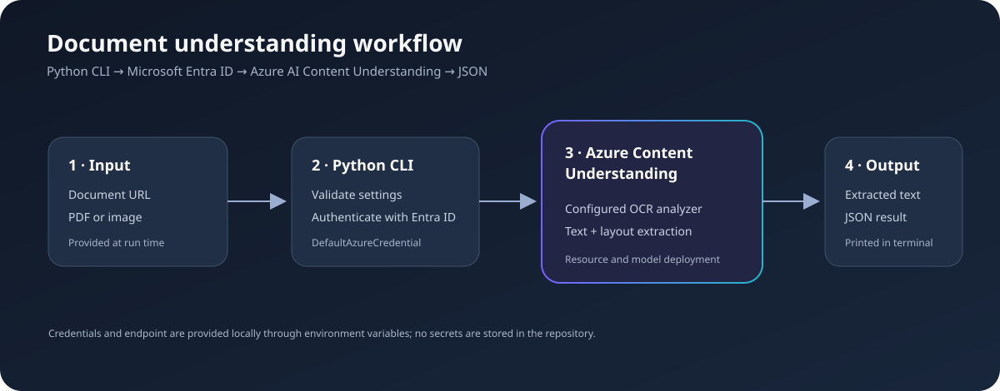

# Azure AI Document OCR and Content Extraction

A portfolio project from my **Azure AI Fundamentals** learning journey. This Python command-line client uses Azure AI Content Understanding to read a document from a URL and return extracted text and structured analysis as JSON.

The original exercise used the Content Understanding playground with the **Document** modality and **OCR/Read** task. This client uses the matching prebuilt-read analyzer through the Python SDK. You need your own Azure resource and configured model dependencies; this repository does not provision Azure resources.

> **Project status:** educational demonstration. This is a local command-line client, not a hosted application. It pins the 2026-06-01-preview service API and preview Python SDK; preview APIs can change and are not recommended for production.

## What it demonstrates

- Calling Azure AI Content Understanding from Python
- Microsoft Entra ID sign-in using DefaultAzureCredential
- Validating input URLs and reading configuration from environment variables
- Starting a long-running document analysis and printing JSON results
- Using a prebuilt analyzer for OCR and document text extraction

## Architecture

The script sends a URL to an existing analyzer. Resource setup, model deployments, and permissions are managed in Azure. The sample does not upload files or create analyzers.

## Playground example

The Foundry Content Understanding playground was used with the Document modality and OCR/Read task. Its capture contains personal contact information in the document preview, so it is not included in this public repository. Use a synthetic or redacted document for shareable screenshots.

## Example input

A publicly reachable PDF or image URL, for example:

~~~text
https://example.com/sample-document.pdf
~~~

By default the client uses Content Understanding's prebuilt-read OCR analyzer. Override it with the CONTENT_UNDERSTANDING_ANALYZER_ID environment variable.

## Example response

The client prints the service result as JSON. This abbreviated example is illustrative, not a captured service response:

~~~json
{
  "status": "Succeeded",
  "result": {
    "contents": [
      {
        "kind": "document",
        "markdown": "# Sample document\n\nInvoice number: DEMO-1042\nTotal: $42.00"
      }
    ]
  }
}
~~~

Exact fields depend on the analyzer, input document, and API version.

## Run locally

### Prerequisites

- Python 3.10 or later
- Azure subscription and Azure AI Content Understanding resource
- Required model deployments and analyzer configured for that resource
- An identity with permission to use the resource
- Azure CLI, or another supported DefaultAzureCredential sign-in method

### Setup (PowerShell)

1. Clone the repository and open its folder.
2. Create and activate a virtual environment:

~~~powershell
py -m venv .venv
.venv\Scripts\Activate.ps1
~~~

3. Install dependencies:

~~~powershell
python -m pip install -r requirements.txt
~~~

4. Sign in and set your own endpoint:

~~~powershell
az login
$env:CONTENT_UNDERSTANDING_ENDPOINT = "https://<your-resource>.services.ai.azure.com/"
~~~

5. Analyze a document URL:

~~~powershell
python agent_client.py "https://example.com/sample-document.pdf"
~~~

The endpoint can also be set in .env if you use a local environment-variable loader, but this sample does not load .env automatically. Never commit API keys, access tokens, private documents, or real endpoints.

## Deployment notes

This project runs locally and calls an Azure Content Understanding resource. To deploy it as a service, add an API or web interface and host it on Azure App Service or Azure Container Apps. Use managed identity with least-privilege access, validate input URLs and document types, set size and processing limits, and add monitoring and data-retention controls before handling real documents.

## Future roadmap

- [ ] Add local file upload and binary analysis
- [ ] Present extracted text in a readable summary
- [ ] Improve retry and authorization/input error handling
- [ ] Add tests for configuration and URL validation
- [ ] Add a synthetic-document demo image after privacy review
- [ ] Build a web interface with managed identity
- [ ] Evaluate extraction quality across document types

## Learning reflection

This exercise introduced me to extracting readable content and structure from documents with Azure AI. I practiced choosing an analysis task, connecting a Python client, configuring a resource, and considering authentication and document privacy in an AI workflow.

## References

- [Azure AI Content Understanding Python SDK](https://learn.microsoft.com/en-us/python/api/overview/azure/ai-contentunderstanding-readme?view=azure-python-preview)
- [ContentUnderstandingClient API reference](https://learn.microsoft.com/en-us/python/api/azure-ai-contentunderstanding/azure.ai.contentunderstanding.contentunderstandingclient)
- [Azure Content Understanding quickstart](https://learn.microsoft.com/en-us/azure/ai-services/content-understanding/quickstart/content-understanding-studio)
- [Microsoft Entra ID authentication with DefaultAzureCredential](https://learn.microsoft.com/en-us/azure/developer/python/sdk/authentication/azure-hosted-apps)
